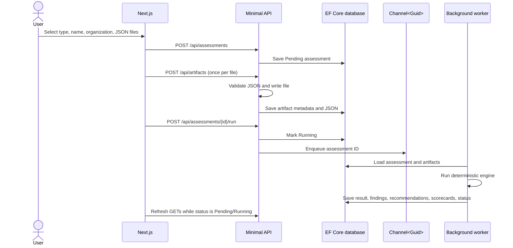

# ArchInsight AI — Technical Overview

**Document status:** describes the repository as implemented on 2026-10-24.  
**Product phase:** Phase 3 AI insights and assessment workflow.  
**Audience:** engineers preparing Phase 4, maintainers, and technical reviewers.

## 1. Scope and current behavior

ArchInsight is a web application for creating and reviewing three rule-based assessment types:

- Modernization
- Data maturity
- Service consistency

The current product supports assessment creation, JSON artifact upload, asynchronous rule execution, persisted deterministic results, optional AI-generated insights and Q&A, historical score trends, assessment comparison, a live-data dashboard, and assessment details. Dashboard values are populated from the API and persisted assessment records.

AI is an optional advisory layer. Deterministic scores, findings, and rule-based recommendations are persisted separately and remain authoritative. Phase 3 does not include agent orchestration, vector search, report export, user authentication, or organization/workspace authorization.

## 2. Architecture

```mermaid
flowchart LR
    Browser[Next.js dashboard and details] -->|HTTP JSON + multipart| Api[ASP.NET Core Minimal API]
    Api --> App[Application layer: MediatR, validation, contracts]
    Api --> AI[ArchInsight.AI: prompts and provider adapter]
    Api --> Infra[Infrastructure: EF Core, file storage, queue]
    App --> Domain[Domain entities and enums]
    Infra --> Domain
    Infra --> Db[(SQLite in Development<br/>SQL Server otherwise)]
    Api --> Queue[In-memory Channel<Guid>]
    Queue --> Worker[Hosted assessment worker]
    Worker --> Engine[Deterministic AssessmentEngine]
    Engine --> App
    Api --> AIQueue[In-memory AI insight queue]
    AIQueue --> AIWorker[Hosted AI insight worker]
    AIWorker --> AI
    AI -->|structured deterministic facts only| Provider[Azure OpenAI preferred / OpenAI fallback]
    Api --> Files[(uploads/{assessmentId}/*.json)]
```

The solution is split into four .NET projects:

| Project | Responsibility |
| --- | --- |
| `backend/ArchInsight.Domain` | Entities and enums with no infrastructure dependency |
| `backend/ArchInsight.Application` | Assessment contracts, MediatR commands/handlers, validation, mapping, and scoring engines |
| `backend/ArchInsight.Infrastructure` | EF Core context/repository and local JSON file storage |
| `backend/ArchInsight.Api` | HTTP routes, dependency configuration, database initialization, seed data, and background worker |
| `backend/ArchInsight.AI` | AI provider adapter, prompt contracts/versioning, structured output models, and local evidence-confidence classifier |

The frontend is a Next.js 15 App Router application in `app/`, written in TypeScript and styled with project CSS. It does not currently use Tailwind or shadcn/ui. The SQL Server reference DDL is in `database/sql/001-create-schema.sql`.

## 3. Technology and configuration

- .NET 9 / ASP.NET Core Minimal APIs
- EF Core 9.0.10 with SQL Server and SQLite providers
- MediatR 12.4.1
- FluentValidation 11.11.0
- Next.js 15.5.6, React 19.1.1, TypeScript
- Local JSON files for artifact bytes; relational database for assessment records and parsed JSON metadata
- `HttpClient`-based Azure OpenAI/OpenAI Chat Completions adapter with JSON mode; no provider SDK dependency

Database selection is controlled by `Database:Provider`:

- `Development` launch profile sets `ASPNETCORE_ENVIRONMENT=Development`; `appsettings.Development.json` selects SQLite. The database file is `backend/ArchInsight.Api/archinsight.db` when run with the project launch profile.
- The base `appsettings.json` selects SQL Server. Configure `ConnectionStrings:SqlServer` for the intended SQL Server instance before using that configuration.
- The API bootstraps with EF Core `EnsureCreated` and then runs `Phase3SchemaUpgrade` to add Phase 3 tables to an existing SQLite or SQL Server database. It does not apply EF migrations. `database/sql/002-phase3-ai-insights.sql` is the standalone SQL Server additive schema script.
- `Cors:Origins` defaults to localhost ports 3000 and 3001. Configure origins for other frontend hosts.
- The frontend reads `NEXT_PUBLIC_API_BASE_URL`; if unset, it uses `http://localhost:5080`.
- Provider configuration is read from `AI:AzureOpenAI:ChatCompletionsUrl`, `AI:AzureOpenAI:ApiKey`, `AI:AzureOpenAI:Deployment`, `AI:OpenAI:ApiKey`, and `AI:OpenAI:Model`. Use environment variables with double underscores or .NET user secrets for credentials. Azure is selected when its full Chat Completions URL, key, and deployment are all configured; otherwise OpenAI is selected when key and model are configured. If neither is configured, deterministic assessments remain fully usable while AI features report not configured.

## 4. Domain and persistence model

The primary entities and relationships are:

```text
Assessment 1 ─── * AssessmentArtifact
Assessment 1 ─── 0..1 AssessmentResult
AssessmentResult 1 ─── * Finding
AssessmentResult 1 ─── * Recommendation
AssessmentResult 1 ─── * ScoreCard
Assessment 1 ─── * AssessmentInsight
AssessmentInsight 1 ─── * AIRecommendation
AssessmentInsight 1 ─── * AIInsightRoadmapItem
Assessment 1 ─── * AIQuestion
```

### Assessment

Stores `Id`, `Name`, `OrganizationName`, `AssessmentType`, `CreatedDate`, `Status`, and an optional `ErrorMessage`. Status values are `Pending`, `Running`, `Completed`, and `Failed`. Assessment types are `Modernization`, `DataMaturity`, and `ServiceConsistency`.

### AssessmentArtifact

Stores an artifact ID, parent assessment ID, `ArtifactType`, original filename, relative disk path, parsed/minified JSON in `MetadataJson`, and upload timestamp. The original JSON bytes are saved under the API content root at `uploads/{assessmentId}/{generatedId}.json`.

### AssessmentResult and children

`AssessmentResult` stores the aggregate score, type-specific recommendation label, deterministic executive summary, count of systems/services where applicable, and completion timestamp. `Finding` stores title, description, category, severity, and a suggested action. `Recommendation` stores priority, title, description, and timeframe. `ScoreCard` stores a named dimension and a 0–100 score.

Enums are persisted as strings. Relationships cascade from assessment to its artifacts/result and from result to its findings, recommendations, and scorecards.

`AssessmentInsight` stores AI-generated narrative fields, confidence, status, provider model, prompt version, token count, and timestamps. Its recommendations and roadmap are child records. `AIQuestion` stores each submitted question and answer with provider metadata and status. Insight generations are append-only: regeneration creates a new insight row and the detail API returns the newest first. The provider never receives uploaded JSON or raw artifact metadata; it receives a compact payload derived from the persisted deterministic result. The evidence-confidence classifier runs locally from evidence coverage and is not a model self-rating.

## 5. Assessment lifecycle



The queue is an unbounded in-process `Channel<Guid>` and the worker processes one assessment at a time. On startup, the API re-enqueues assessments already marked `Pending` or `Running`, so persisted work can be retried after a process restart. The frontend polls every 1.8 seconds while any listed assessment is pending or running; the detail page also polls while its selected assessment is running.

If the engine throws, the worker marks the assessment `Failed` and persists the exception message in `ErrorMessage`. A failed assessment can be queued again. Completed and currently running assessments cannot be queued again through the run endpoint.

## 6. Artifact formats and ingestion

Only `.json` files are accepted. The API enforces a non-empty file size up to 2 MiB and parses JSON before storage. The browser also checks the extension, size, and JSON syntax before creating an assessment. The API persists the raw file on disk and the normalized JSON representation in the database; the engine reads the database metadata JSON.

The included examples are downloadable in the assessment dialog and live in `public/samples/`:

- `modernization.json`: an `applications` array. Each application may contain `name`, `framework`, `database`, `hosting`, `containerized`, `architecture`, and `supportedRuntime`.
- `data-maturity.json`: boolean capabilities such as `dataOwnersDefined`, `catalogAvailable`, `qualityMonitoring`, `pipelineMonitoring`, `warehouseAvailable`, `selfServiceAnalytics`, `consistentMetrics`, `structuredDatasets`, `featureManagement`, and `vectorSearch`.
- `service-consistency.json`: a `services` array with service name, version, authentication/error format, and schema fields. Raw OpenAPI objects with `info.title` and paths are also recognized.

The `ArtifactType` enum includes architecture documents, technology/database inventories, OpenAPI specifications, service manifests, source code summaries, and data platform inventories. The current browser assigns a type based on the assessment type; the engine primarily interprets JSON contents rather than branching on the artifact type.

## 7. Deterministic scoring rules

All rules in `AssessmentEngine` are applied once per assessment condition: if any recognized application/service triggers a condition, that condition contributes one penalty/finding, regardless of how many records match. Scores are clamped to 0–100. This is a baseline policy implementation, not a calibrated architecture benchmark.

### 7.1 Modernization

The engine recursively finds objects with at least one of `framework`, `database`, `hosting`, `containerized`, or `architecture`. It starts at 100 and applies:

| Condition found in any application | Score change | Severity |
| --- | ---: | --- |
| `.NET Framework` version parses below 4.8 (or version text is unparseable after matching `.NET Framework`) | −20 | High |
| Database string contains `SQL Server 2012` | −15 | Critical |
| Hosting string contains `IIS` | −10 | Medium |
| `containerized` is false or absent | −15 | Medium |
| Architecture string contains `monolith` | −20 | High |
| Any application explicitly sets `supportedRuntime: true` | +10 | — |

The recommendation uses the final score: 0–39 `Rewrite`, 40–59 `Refactor`, 60–79 `Replatform`, and 80–100 `Lift-and-Shift`. Four roadmap recommendations are generated for every valid modernization assessment, regardless of findings: framework upgrade (0–3 months), containerization (3–6 months), data layer modernization (6–12 months), and cloud migration (12+ months).

### 7.2 Data maturity

The engine selects the first recursively encountered JSON object with a recognized data capability field. Each dimension is calculated as the number of true signals divided by the number of signals assigned to that dimension, multiplied by 100 and rounded down to an integer:

| Dimension | Input signals |
| --- | --- |
| Governance | `dataOwnersDefined`, `catalogAvailable` |
| Quality | `qualityMonitoring` |
| Platform | `warehouseAvailable` |
| Observability | `pipelineMonitoring` |
| Analytics | `selfServiceAnalytics`, `consistentMetrics` |
| AI Readiness | `structuredDatasets`, `featureManagement`, `vectorSearch` |

False or missing signals score zero. The overall score is the arithmetic mean of the six dimension scores, rounded to the nearest integer with midpoint values rounded away from zero. Each dimension is persisted as a separate scorecard.

Missing-evidence findings are currently generated for owners, catalog, quality monitoring, pipeline monitoring, warehouse, self-service analytics, and structured datasets. Although metrics and feature-management/vector-search fields affect scores, missing values for those three fields do not currently generate individual findings. Recommendations are generated from the first four missing-evidence findings. The inventory is treated as one data platform assessment, not as a count of applications.

### 7.3 Service consistency

The engine recognizes service objects with a `name` or `info.title` and at least one service/OpenAPI field (`paths`, `openapi`, `authentication`, `auth`, or `schemas`). It requires at least two recognized services.

It generates at most one finding for each cross-service check:

- **Naming:** detects more than one exact spelling among `CustomerId`, `customerID`, and `cust_id` in nested schema properties with `type` or `$ref`.
- **Versioning:** compares `apiVersion`, `info.version`, or `version`; it also searches string values for a `v<number>` path segment. Plain dotted numeric versions are reduced to their first number with a `v` prefix.
- **Error formats:** uses explicit `errorFormat`, otherwise searches descendant property names for `error` or the pair `code` and `message`. Other cases become `unknown`.
- **Authentication:** uses `authentication` or `auth`, otherwise derives a value from OpenAPI `components.securitySchemes`. OAuth2 maps to `OAuth`; a bearer scheme maps to `JWT`; absent schemes map to `None`.

Different naming/version signals create Medium findings; different error formats and authentication approaches create High findings. Each Medium finding deducts 12 points; each High finding deducts 20 points. The scorecard includes API design, error handling, authentication, and data contracts. Service roadmap recommendations are generated from findings, with the first two in 0–3 months and later items in 3–6 months.

These are lightweight structural heuristics. The engine does not yet validate all OpenAPI semantics, HTTP routes, response codes, authorization policy, telemetry, schema compatibility, package/framework drift, or breaking changes.

## 8. HTTP API

The API uses JSON string values for enums. Local base URL is `http://localhost:5080`.

| Method and route | Purpose | Typical responses |
| --- | --- | --- |
| `GET /health` | Liveness endpoint | `200` |
| `GET /api/assessments` | List assessment summaries, newest first | `200` |
| `GET /api/assessments/{id}` | Fetch assessment, artifacts, scorecards, findings, and recommendations | `200`, `404` |
| `POST /api/assessments` | Create an assessment | `201`, `400` validation problem |
| `POST /api/artifacts?assessmentId={guid}&type={ArtifactType}` | Multipart upload with form field `file` | `201`, `400`, `404`, `409` |
| `POST /api/assessments/{id}/run` | Queue processing | `202`, `400`, `409` |
| `POST /api/assessments/{id}/insights/regenerate` | Queue manual insight regeneration | `202`, `404`, `409`, `503` |
| `POST /api/assessments/{id}/ask` | Answer and persist an assessment question | `201`, `400`, `404`, `409`, `502`, `503` |
| `GET /api/assessments/compare?id={baseline}&id={comparison}` | Compare two completed assessments of the same type; add an AI explanation when configured | `200`, `400`, `404` |

Create request:

```json
{
  "name": "Customer platform review",
  "organizationName": "Northstar Group",
  "assessmentType": "Modernization"
}
```

An assessment must exist and remain `Pending` to accept artifacts. `type` must be an `ArtifactType` enum value. An upload must be valid JSON, have a `.json` extension, and be no larger than 2 MiB. The run endpoint requires at least one uploaded artifact.

The list endpoint returns summary fields: ID, name, organization, type, status, creation date, score, recommendation, and finding count. The detail endpoint adds completion date, executive summary, system count, error message, scorecards, complete finding/recommendation DTOs, artifact filenames, all insight generations with their child recommendations/roadmap, and saved Q&A history. The compare route requires exactly two repeated `id` parameters and rejects different assessment types or incomplete assessments. Its score, finding, score-area, and severity changes are deterministic; the optional AI explanation is additive.

Insight regeneration requires an enabled provider and a completed deterministic assessment. Automatic generation queues once after assessment completion and once during startup only for completed assessments that have no prior completed or in-flight insight. Dashboard reads do not trigger provider calls. Questions are stored before the provider call; an unconfigured provider produces a persisted `NotConfigured` question and a `503` response. AI failures do not change deterministic assessment status.

## 9. Frontend behavior

`app/page.tsx` is the overview dashboard. It fetches the assessment list and then the latest listed assessment for each type. Score tiles, finding counts, assessment status, recent runs, and deterministic recommendations are built from those API responses. AI insight summaries, confidence, model/token provenance, and manual regeneration controls use persisted insight records. Trend cards use up to the latest eight completed assessments of each type. Comparison makes an explicit API request only after the user selects and compares two records. The findings and recommendations panels aggregate the latest detail for each assessment type rather than every historical run.

The assessment dialog accepts one assessment type per assessment, a name and organization, and one or more JSON files. It creates the assessment, uploads files sequentially, and queues the run. The detail route `app/assessments/[id]/page.tsx` renders deterministic results separately from AI insights, the AI recommendations and roadmap, confidence/provenance, saved question-and-answer history, and artifact filenames. It polls while either deterministic execution or insight generation is pending. The shell still uses demo labels (Northstar Group, Jordan/admin); the organization field defaults to Northstar Group but is editable.

If the API is unreachable, the overview displays an API warning and disables assessment submission. If upload fails after assessment creation, the assessment record remains pending (and may contain earlier successful uploads); the current interface does not offer a resume-upload flow from that error state.

## 10. Seed data

At API startup, `EnsureCreated` runs and the seeder checks whether any assessment exists. If the database is empty, it creates one completed assessment for each type under Northstar Group and runs the same deterministic engine used for user-created assessments. The modernization seed contains Customer Portal, Order API, Billing Service, and Reporting Portal records with intentionally poor characteristics. The other seed records intentionally omit data capabilities and vary service naming/version/error/authentication fields.

If any assessment already exists, seeding is skipped entirely. The seed artifact JSON is stored in database metadata; seed files are not written to the uploads folder.

## 11. Local development

From the repository root, start the API:

```powershell
dotnet run --project backend/ArchInsight.Api
```

The launch profile selects Development and binds to `http://localhost:5080`. In a second terminal:

```powershell
npm install
npm run dev
```

The frontend is available at `http://localhost:3000`. Example JSON can be downloaded from the assessment form. To build the backend solution and production frontend:

```powershell
dotnet build ArchInsight.sln -m:1
npm run build
```

## 12. AI insight and comparison workflow

The API hosts two independent in-memory queues and workers. `AssessmentWorker` runs the deterministic engine, persists `AssessmentResult`, marks the assessment completed, then creates one pending insight record and queues it. `AIInsightWorker` loads the assessment with its deterministic result, transitions the insight through `Running`, calls `IAIInsightGenerator`, and persists the narrative, five AI recommendations, four roadmap entries, model/prompt metadata, token usage, confidence, and completion time. Provider failures are saved on the insight and do not alter deterministic status. Persisted pending/running work is requeued on startup. These channels are process-local and do not coordinate multiple API instances.

`OpenAiInsightGenerator` implements the provider boundary in `ArchInsight.AI`. Azure OpenAI is selected only when a full Chat Completions URL, API key, and deployment are supplied; otherwise a configured OpenAI key and model select OpenAI. Provider requests use the Chat Completions JSON response mode. `InsightPrompts` versions the prompt as `phase3-v1`. Deterministic scores, findings, scorecards, and rule-based recommendations are assembled into the provider payload. Uploaded artifact bytes and `MetadataJson` are not sent. The model's strategy recommendation is not allowed to overwrite the deterministic recommendation; persisted `RecommendedStrategy` reflects that deterministic strategy label. Confidence is classified locally from presence/coverage signals.

`GET /api/assessments/compare` uses a deterministic service to compare two completed assessments of the same type. It reports score movement, finding changes, dimension/category movement, and severity counts. If a provider is configured, the API also requests an optional explanation; provider failure leaves the deterministic comparison available with an error field. Q&A is synchronous in the request path, persists its pending/running/completed/failed state and provider usage, and includes only the structured assessment facts and latest completed insight in its provider context.

The dashboard shows one latest insight per assessment type, historical trends from up to eight completed runs, and a comparison selector. The detail page shows all generated insight dimensions and a separate AI recommendation/roadmap section. Manual regeneration is explicit; dashboard reads do not call the AI provider. AI features are optional and require configuration.

## 13. Current limitations and Phase 4 seams

Current implementation limits to account for before building on it:

- The queue is in-memory and unbounded; startup recovery retries persisted `Running`/`Pending` records, but there is no distributed queue, concurrency policy, retry/backoff policy, or cancellation endpoint.
- `GET /api/assessments` loads assessments and their result graphs before sorting in application memory. This avoids SQLite's unsupported `DateTimeOffset` ordering translation and is suitable only for small demo datasets.
- Database initialization uses `EnsureCreated` plus a focused additive Phase 3 schema upgrade, not versioned EF migrations. Review the startup SQL and standalone SQL Server script against the EF model when adding future schema changes.
- Uploads are local filesystem files. There is no artifact download/delete endpoint, retention policy, malware scan, storage abstraction beyond the local implementation, or cleanup of a disk file if the subsequent database save fails.
- The API has no authentication, authorization, tenant isolation, rate limits, or audit trail. Workspace/organization names are data fields rather than security boundaries.
- The current UI sends artifacts to the local API origin and does not support retrying an upload/run from an existing pending assessment.
- Assessment rules are intentionally narrow and have no persisted ruleset/version identifier. AI interpretation inherits the accuracy and coverage limitations of those rules and uploaded evidence.
- AI generation has no retry/backoff policy, request rate limits, concurrency limit, spend budget enforcement, provider circuit breaker, streaming, or user cancellation. Queue state is persisted, but the underlying channels are in-memory and unbounded.
- Insight summary word-count and recommendation/roadmap count requirements are validated at the provider boundary; provider output can fail validation and be recorded as a failed insight. The current manual regenerate route permits new generations after prior failures or completion, which can incur provider cost.
- The AI provider adapter is configured through environment/configuration, but the UI does not expose provider settings. The application has no authentication, authorization, tenant isolation, or per-user audit, so it is suitable only for a trusted demo environment.
- The project has no automated test project or CI pipeline in the repository. Build checks do not prove behavior against a running SQL Server or external AI provider.
- Phase 4 can build on `IAIInsightGenerator`, `IAIInsightQueue`, the insight persistence model, and deterministic result contracts. Agent orchestration, source/dependency analysis, security and operational dimensions, executive export, PostgreSQL, deployment, and auth remain outside this implementation.
