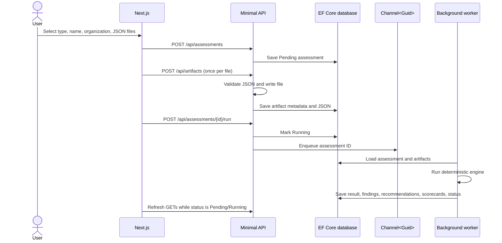

# ArchInsight AI — Technical Overview

**Document status:** describes the repository as implemented on 2026-10-25.
**Product phase:** Phase 5 transformation simulation and portfolio planning.
**Audience:** engineers preparing the next product phase, maintainers, and technical reviewers.

## 1. Scope and current behavior

ArchInsight is a web application for creating and reviewing three rule-based assessment types, discovering repository inventories, and evaluating modernization scenarios:

- Modernization
- Data maturity
- Service consistency

The current product supports manual JSON assessment creation and ZIP-based repository discovery. Repository analysis extracts structured .NET, Node.js, Python, Docker, GitHub Actions, and OpenAPI metadata; generates modernization/service artifacts; executes specialized deterministic agent stages; persists inventory and a CycloneDX SBOM; and queues applicable assessments. The platform also supports optional AI insights and Q&A, historical score trends, assessment comparison, an inventory dashboard, a risk heatmap, printable assessment reports, deterministic transformation scenarios, portfolio prioritization, dependency impact analysis, and an executive investment roadmap.

AI is an optional advisory layer. Deterministic scores, findings, discovery rules, simulation projections, and recommendations remain authoritative. Discovery reads repository manifests and contracts; it is not a source-code semantic analyzer, runtime scanner, vulnerability database, hosted Git integration, or proof of deployed behavior. Simulation outputs are relative planning heuristics, not delivery estimates or financial ROI. Dependency edges are explicitly recorded and should be validated by architecture teams. Phases 4–5 do not add multi-tenant authorization or production agent controls.

## 2. Architecture

```mermaid
flowchart LR
    Browser[Next.js dashboard and details] -->|HTTP JSON + multipart| Api[ASP.NET Core Minimal API]
    Api --> App[Application layer: MediatR, validation, contracts]
    Api --> AI[ArchInsight.AI: prompts and provider adapter]
    Api --> Analysis[ArchInsight.Analysis: safe ZIP and manifest analyzer]
    Api --> Agents[ArchInsight.Agents: specialized orchestration]
    Api --> Infra[Infrastructure: EF Core, file storage, queue]
    App --> Domain[Domain entities and enums]
    Infra --> Domain
    Infra --> Db[(SQLite in Development<br/>SQL Server otherwise)]
    Api --> Queue[In-memory Channel<Guid>]
    Queue --> Worker[Hosted assessment worker]
    Worker --> Engine[Deterministic AssessmentEngine]
    Engine --> App
    Api --> AIQueue[In-memory AI insight queue]
    AIQueue --> AIWorker[Hosted AI insight worker]
    AIWorker --> AI
    AI -->|structured deterministic facts only| Provider[Azure OpenAI preferred / OpenAI fallback]
    Analysis --> Agents
    Agents -->|generated inventories and findings| DB
    Api --> Files[(uploads/{assessmentId}/*.json)]
```

The solution is split into six .NET projects:

| Project | Responsibility |
| --- | --- |
| `backend/ArchInsight.Domain` | Entities and enums with no infrastructure dependency |
| `backend/ArchInsight.Application` | Assessment contracts, MediatR commands/handlers, validation, mapping, and scoring engines |
| `backend/ArchInsight.Infrastructure` | EF Core context/repository and local JSON file storage |
| `backend/ArchInsight.Api` | HTTP routes, dependency configuration, schema upgrades, seed data, queues, and hosted workers |
| `backend/ArchInsight.AI` | AI provider adapter, prompt contracts/versioning, structured output models, and local evidence-confidence classifier |
| `backend/ArchInsight.Analysis` | ZIP inspection, project/package/OpenAPI/Docker/workflow parsing, normalized inventory DTOs, and CycloneDX generation |
| `backend/ArchInsight.Agents` | `IAgent` contracts, ordered orchestration, deterministic artifact, modernization, service-governance, and technology-risk agents, and executive-stage contracts |

The frontend is a Next.js 15 App Router application in `app/`, written in TypeScript and styled with project CSS. It does not currently use Tailwind or shadcn/ui. The SQL Server reference DDL is in `database/sql/001-create-schema.sql`.

## 3. Technology and configuration

- .NET 9 / ASP.NET Core Minimal APIs
- EF Core 9.0.10 with SQL Server and SQLite providers
- MediatR 12.4.1
- FluentValidation 11.11.0
- Next.js 15.5.6, React 19.1.1, TypeScript
- Local JSON files for artifact bytes; relational database for assessment records and parsed JSON metadata
- `HttpClient`-based Azure OpenAI/OpenAI Chat Completions adapter with JSON mode; no provider SDK dependency
- `System.IO.Compression` ZIP inspection without extraction; hard limits of 25 MiB compressed, 100 MiB expanded, 5,000 entries, and 8 MiB per parsed text file
- CycloneDX 1.5 JSON SBOM output from discovered components

Database selection is controlled by `Database:Provider`:

- `Development` launch profile sets `ASPNETCORE_ENVIRONMENT=Development`; `appsettings.Development.json` selects SQLite. The database file is `backend/ArchInsight.Api/archinsight.db` when run with the project launch profile.
- The base `appsettings.json` selects SQL Server. Configure `ConnectionStrings:SqlServer` for the intended SQL Server instance before using that configuration.
- The API bootstraps with EF Core `EnsureCreated` and then runs additive Phase 3 and Phase 4 schema-upgrade code to support existing SQLite/SQL Server demo databases. It does not apply EF migrations. SQL Server reference and additive scripts live in `database/sql/`.
- `Cors:Origins` defaults to localhost ports 3000 and 3001. Configure origins for other frontend hosts.
- The frontend reads `NEXT_PUBLIC_API_BASE_URL`; if unset, it uses `http://localhost:5080`.
- Provider configuration is read from `AI:AzureOpenAI:ChatCompletionsUrl`, `AI:AzureOpenAI:ApiKey`, `AI:AzureOpenAI:Deployment`, `AI:OpenAI:ApiKey`, and `AI:OpenAI:Model`. Use environment variables with double underscores or .NET user secrets for credentials. Azure is selected when its full Chat Completions URL, key, and deployment are all configured; otherwise OpenAI is selected when key and model are configured. If neither is configured, deterministic assessments remain fully usable while AI features report not configured.

## 4. Domain and persistence model

The primary entities and relationships are:

```text
Assessment 1 ─── * AssessmentArtifact
Assessment 1 ─── 0..1 AssessmentResult
AssessmentResult 1 ─── * Finding
AssessmentResult 1 ─── * Recommendation
AssessmentResult 1 ─── * ScoreCard
Assessment 1 ─── * AssessmentInsight
AssessmentInsight 1 ─── * AIRecommendation
AssessmentInsight 1 ─── * AIInsightRoadmapItem
Assessment 1 ─── * AIQuestion
RepositoryAnalysis 1 ─── * Assessment
RepositoryAnalysis 1 ─── * DiscoveredApplication
RepositoryAnalysis 1 ─── * DiscoveredService
RepositoryAnalysis 1 ─── * TechnologyDependency
RepositoryAnalysis 1 ─── * SoftwareInventory
RepositoryAnalysis 1 ─── * RepositoryAgentStage
Assessment 1 ─── * AssessmentVersion
```

### Assessment

Stores `Id`, `Name`, `OrganizationName`, `AssessmentType`, `CreatedDate`, `Status`, and an optional `ErrorMessage`. Status values are `Pending`, `Running`, `Completed`, and `Failed`. Assessment types are `Modernization`, `DataMaturity`, and `ServiceConsistency`.

### AssessmentArtifact

Stores an artifact ID, parent assessment ID, `ArtifactType`, original filename, relative disk path, parsed/minified JSON in `MetadataJson`, and upload timestamp. The original JSON bytes are saved under the API content root at `uploads/{assessmentId}/{generatedId}.json`.

### AssessmentResult and children

`AssessmentResult` stores the aggregate score, type-specific recommendation label, deterministic executive summary, count of systems/services where applicable, and completion timestamp. `Finding` stores title, description, category, severity, and a suggested action. `Recommendation` stores priority, title, description, and timeframe. `ScoreCard` stores a named dimension and a 0–100 score.

Enums are persisted as strings. Relationships cascade from assessment to its artifacts/result and from result to its findings, recommendations, and scorecards.

`AssessmentInsight` stores AI-generated narrative fields, confidence, status, provider model, prompt version, token count, and timestamps. Its recommendations and roadmap are child records. `AIQuestion` stores each submitted question and answer with provider metadata and status. Insight generations are append-only: regeneration creates a new insight row and the detail API returns the newest first. The provider never receives uploaded JSON or raw artifact metadata; it receives a compact payload derived from the persisted deterministic result. The evidence-confidence classifier runs locally from evidence coverage and is not a model self-rating.

`RepositoryAnalysis` represents one uploaded ZIP and stores its local archive path, SHA-256 hash, normalized summary, and SBOM. Child rows store discovered applications, OpenAPI services/routes/schemas/auth schemes, package/framework/container dependencies and rule risk, software inventory categories, and each agent's persisted stage output. Multiple generated assessments can point to one repository analysis. `AssessmentVersion` stores an incremented result snapshot plus ruleset, prompt, and assessment labels. Repository maturity scorecards (Security, DevOps, Cloud Readiness, Observability) are auxiliary signals and are excluded from the deterministic overall score.

## 5. Assessment lifecycle



The queue is an unbounded in-process `Channel<Guid>` and the worker processes one assessment at a time. On startup, the API re-enqueues assessments already marked `Pending` or `Running`, so persisted work can be retried after a process restart. The frontend polls every 1.8 seconds while any listed assessment is pending or running; the detail page also polls while its selected assessment is running.

If the engine throws, the worker marks the assessment `Failed` and persists the exception message in `ErrorMessage`. A failed assessment can be queued again. Completed and currently running assessments cannot be queued again through the run endpoint.

For a repository ZIP, `RepositoryZipAnalyzer` reads candidate text entries in memory without extracting paths to disk. `AgentOrchestrator` runs Artifact Discovery, Modernization, Service Governance, and Technology Risk; each output is persisted as `RepositoryAgentStage`. The API saves repository/application/service/dependency/SBOM inventory plus generated `TechnologyInventory` and (when at least two APIs were found) `ServiceManifest` artifacts. It creates and queues applicable deterministic assessments. On completion the assessment worker adds applicable discovery-rule findings, four auxiliary maturity dimensions, and an `AssessmentVersion`; the existing AI worker then writes the AI insight stage and executive advisor package to the repository's stage history.

## 6. Artifact formats and ingestion

Manual artifacts accept `.json` files up to 2 MiB and are parsed before storage. The API persists raw JSON on disk and parsed JSON in the database; the assessment engine reads the database metadata.

Repository discovery accepts `.zip` up to 25 MiB compressed. The analyzer applies a 100 MiB total expanded-size limit, 5,000-entry limit, and 8 MiB per parsed text file. It skips unsafe paths and common generated/vendor directories (`.git`, `node_modules`, `bin`, `obj`, `dist`, `.next`); it never extracts entries. The original ZIP is retained locally under the uploads folder. The analyzer currently parses `.csproj`/`.fsproj`/`.vbproj` target frameworks and package references, `package.json` dependencies/devDependencies, Python `requirements.txt`/basic `pyproject.toml` requirements, Dockerfile and compose images, GitHub Actions workflow names/build/deploy cues, `appsettings*.json` database technology/version signals without saving connection-string values, and JSON files named `openapi.json`/`swagger.json`.

OpenAPI discovery records title, version, HTTP method/path pairs, schema names, and declared authentication schemes. API route extraction is from JSON OpenAPI/Swagger only; YAML contracts are not currently parsed. The generated modernization/service artifacts are inputs to the existing rules engine, so imported service consistency assessments require at least two recognized OpenAPI documents. A single API is still retained in the repository inventory.

The included examples are downloadable in the assessment dialog and live in `public/samples/`:

- `modernization.json`: an `applications` array. Each application may contain `name`, `framework`, `database`, `hosting`, `containerized`, `architecture`, and `supportedRuntime`.
- `data-maturity.json`: boolean capabilities such as `dataOwnersDefined`, `catalogAvailable`, `qualityMonitoring`, `pipelineMonitoring`, `warehouseAvailable`, `selfServiceAnalytics`, `consistentMetrics`, `structuredDatasets`, `featureManagement`, and `vectorSearch`.
- `service-consistency.json`: a `services` array with service name, version, authentication/error format, and schema fields. Raw OpenAPI objects with `info.title` and paths are also recognized.

The `ArtifactType` enum includes architecture documents, technology/database inventories, OpenAPI specifications, service manifests, source code summaries, and data platform inventories. The current browser assigns a type based on the assessment type; the engine primarily interprets JSON contents rather than branching on the artifact type.

## 7. Deterministic scoring rules

All rules in `AssessmentEngine` are applied once per assessment condition: if any recognized application/service triggers a condition, that condition contributes one penalty/finding, regardless of how many records match. Scores are clamped to 0–100. This is a baseline policy implementation, not a calibrated architecture benchmark.

### 7.1 Modernization

The engine recursively finds objects with at least one of `framework`, `database`, `hosting`, `containerized`, or `architecture`. It starts at 100 and applies:

| Condition found in any application | Score change | Severity |
| --- | ---: | --- |
| `.NET Framework` version parses below 4.8 (or version text is unparseable after matching `.NET Framework`) | −20 | High |
| Database string contains `SQL Server 2012` | −15 | Critical |
| Hosting string contains `IIS` | −10 | Medium |
| `containerized` is false or absent | −15 | Medium |
| Architecture string contains `monolith` | −20 | High |
| Any application explicitly sets `supportedRuntime: true` | +10 | — |

The recommendation uses the final score: 0–39 `Rewrite`, 40–59 `Refactor`, 60–79 `Replatform`, and 80–100 `Lift-and-Shift`. Four roadmap recommendations are generated for every valid modernization assessment, regardless of findings: framework upgrade (0–3 months), containerization (3–6 months), data layer modernization (6–12 months), and cloud migration (12+ months).

### 7.2 Data maturity

The engine selects the first recursively encountered JSON object with a recognized data capability field. Each dimension is calculated as the number of true signals divided by the number of signals assigned to that dimension, multiplied by 100 and rounded down to an integer:

| Dimension | Input signals |
| --- | --- |
| Governance | `dataOwnersDefined`, `catalogAvailable` |
| Quality | `qualityMonitoring` |
| Platform | `warehouseAvailable` |
| Observability | `pipelineMonitoring` |
| Analytics | `selfServiceAnalytics`, `consistentMetrics` |
| AI Readiness | `structuredDatasets`, `featureManagement`, `vectorSearch` |

False or missing signals score zero. The overall score is the arithmetic mean of the six dimension scores, rounded to the nearest integer with midpoint values rounded away from zero. Each dimension is persisted as a separate scorecard.

Missing-evidence findings are currently generated for owners, catalog, quality monitoring, pipeline monitoring, warehouse, self-service analytics, and structured datasets. Although metrics and feature-management/vector-search fields affect scores, missing values for those three fields do not currently generate individual findings. Recommendations are generated from the first four missing-evidence findings. The inventory is treated as one data platform assessment, not as a count of applications.

### 7.3 Service consistency

The engine recognizes service objects with a `name` or `info.title` and at least one service/OpenAPI field (`paths`, `openapi`, `authentication`, `auth`, or `schemas`). It requires at least two recognized services.

It generates at most one finding for each cross-service check:

- **Naming:** detects more than one exact spelling among `CustomerId`, `customerID`, and `cust_id` in nested schema properties with `type` or `$ref`.
- **Versioning:** compares `apiVersion`, `info.version`, or `version`; it also searches string values for a `v<number>` path segment. Plain dotted numeric versions are reduced to their first number with a `v` prefix.
- **Error formats:** uses explicit `errorFormat`, otherwise searches descendant property names for `error` or the pair `code` and `message`. Other cases become `unknown`.
- **Authentication:** uses `authentication` or `auth`, otherwise derives a value from OpenAPI `components.securitySchemes`. OAuth2 maps to `OAuth`; a bearer scheme maps to `JWT`; absent schemes map to `None`.

Different naming/version signals create Medium findings; different error formats and authentication approaches create High findings. Each Medium finding deducts 12 points; each High finding deducts 20 points. The scorecard includes API design, error handling, authentication, and data contracts. Service roadmap recommendations are generated from findings, with the first two in 0–3 months and later items in 3–6 months.

These are lightweight structural heuristics. The engine does not yet validate all OpenAPI semantics, HTTP routes, response codes, authorization policy, telemetry, schema compatibility, package/framework drift, or breaking changes.

## 8. HTTP API

The API uses JSON string values for enums. Local base URL is `http://localhost:5080`.

| Method and route | Purpose | Typical responses |
| --- | --- | --- |
| `GET /health` | Liveness endpoint | `200` |
| `GET /api/assessments` | List assessment summaries, newest first | `200` |
| `GET /api/assessments/{id}` | Fetch assessment, artifacts, scorecards, findings, and recommendations | `200`, `404` |
| `POST /api/assessments` | Create an assessment | `201`, `400` validation problem |
| `POST /api/artifacts?assessmentId={guid}&type={ArtifactType}` | Multipart upload with form field `file` | `201`, `400`, `404`, `409` |
| `POST /api/assessments/{id}/run` | Queue processing | `202`, `400`, `409` |
| `POST /api/assessments/{id}/insights/regenerate` | Queue manual insight regeneration | `202`, `404`, `409`, `503` |
| `POST /api/assessments/{id}/ask` | Answer and persist an assessment question | `201`, `400`, `404`, `409`, `502`, `503` |
| `GET /api/assessments/compare?id={baseline}&id={comparison}` | Compare two completed assessments of the same type; add an AI explanation when configured | `200`, `400`, `404` |
| `POST /api/repositories/analyze` | Multipart repository discovery (`file`, optional `name`, `organizationName`) and queue generated assessments | `201`, `400`, `413` |
| `GET /api/inventory` | List repository architecture inventories with applications, APIs, dependencies, agent stages, assessment links, and SBOM data | `200` |
| `GET /api/repositories/{id}` | Fetch one repository inventory | `200`, `404` |
| `GET /api/repositories/{id}/sbom` | Download the generated CycloneDX 1.5 JSON SBOM | `200`, `404` |

Create request:

```json
{
  "name": "Customer platform review",
  "organizationName": "Northstar Group",
  "assessmentType": "Modernization"
}
```

An assessment must exist and remain `Pending` to accept artifacts. `type` must be an `ArtifactType` enum value. An upload must be valid JSON, have a `.json` extension, and be no larger than 2 MiB. The run endpoint requires at least one uploaded artifact.

The list endpoint returns summary fields: ID, name, organization, type, status, creation date, score, recommendation, and finding count. The detail endpoint adds completion date, executive summary, system count, error message, scorecards, complete finding/recommendation DTOs, artifact filenames, all insight generations with their child recommendations/roadmap, and saved Q&A history. The compare route requires exactly two repeated `id` parameters and rejects different assessment types or incomplete assessments. Its score, finding, score-area, and severity changes are deterministic; the optional AI explanation is additive.

Repository discovery accepts a multipart ZIP no larger than 25 MiB and optional form fields `name` and `organizationName`. It returns repository id/hash, counts, warnings, generated assessments, inventory URL, and SBOM URL. It creates a Modernization assessment when one or more applications are recognized and a ServiceConsistency assessment when at least two OpenAPI services are recognized. Unsupported archives can still produce a repository row with warnings and no generated assessments.

Insight regeneration requires an enabled provider and a completed deterministic assessment. Automatic generation queues once after assessment completion and once during startup only for completed assessments that have no prior completed or in-flight insight. Dashboard reads do not trigger provider calls. Questions are stored before the provider call; an unconfigured provider produces a persisted `NotConfigured` question and a `503` response. AI failures do not change deterministic assessment status.

## 9. Frontend behavior

`app/page.tsx` is the overview dashboard. It fetches the assessment list, latest detail per type, and repository inventory. In addition to scoring and AI sections, it includes repository ZIP intake, technology distribution, application/framework/database inventory, API route/auth/schema inventory, dependency/risk tables, agent-stage status, SBOM download, and an application risk heatmap. Business impact is a small name-based heuristic for demonstration and must be verified with application owners; technical-risk values come from configured deterministic discovery rules plus missing-container/build evidence. Trend cards use up to the latest eight completed assessments of each type. Comparison makes an explicit API request only after the user selects and compares two records.

The manual assessment dialog accepts a name, organization, assessment type, and JSON files. Repository intake is a separate modal in the dashboard. Assessment detail renders deterministic results separately from AI insights, generated repository technologies/dependency risks, auxiliary maturity dimensions, version metadata, AI recommendations/roadmap, and saved Q&A. The print action opens the browser print dialog; select “Save as PDF” to export the currently rendered executive assessment. The shell still uses demo labels (Northstar Group, Jordan/admin); organization is editable.

If the API is unreachable, the overview displays an API warning and disables assessment submission. If upload fails after assessment creation, the assessment record remains pending (and may contain earlier successful uploads); the current interface does not offer a resume-upload flow from that error state.

## 10. Seed data

At API startup, `EnsureCreated` runs and the seeder checks whether any assessment exists. If the database is empty, it creates one completed assessment for each type under Northstar Group and runs the same deterministic engine used for user-created assessments. The modernization seed contains Customer Portal, Order API, Billing Service, and Reporting Portal records with intentionally poor characteristics. The other seed records intentionally omit data capabilities and vary service naming/version/error/authentication fields.

If any assessment already exists, seeding is skipped entirely. The seed artifact JSON is stored in database metadata; seed files are not written to the uploads folder.

## 11. Local development

From the repository root, start the API:

```powershell
dotnet run --project backend/ArchInsight.Api
```

The launch profile selects Development and binds to `http://localhost:5080`. In a second terminal:

```powershell
npm install
npm run dev
```

The frontend is available at `http://localhost:3000`. Example JSON can be downloaded from the assessment form. To build the backend solution and production frontend:

```powershell
dotnet build ArchInsight.sln -m:1
npm run build
```

## 12. AI insight and comparison workflow

The API hosts two independent in-memory queues and workers. `AssessmentWorker` runs the deterministic engine, persists `AssessmentResult`, marks the assessment completed, then creates one pending insight record and queues it. `AIInsightWorker` loads the assessment with its deterministic result, transitions the insight through `Running`, calls `IAIInsightGenerator`, and persists the narrative, five AI recommendations, four roadmap entries, model/prompt metadata, token usage, confidence, and completion time. Provider failures are saved on the insight and do not alter deterministic status. Persisted pending/running work is requeued on startup. These channels are process-local and do not coordinate multiple API instances.

`OpenAiInsightGenerator` implements the provider boundary in `ArchInsight.AI`. Azure OpenAI is selected only when a full Chat Completions URL, API key, and deployment are supplied; otherwise a configured OpenAI key and model select OpenAI. Provider requests use the Chat Completions JSON response mode. `InsightPrompts` versions the prompt as `phase3-v1`. Deterministic scores, findings, scorecards, and rule-based recommendations are assembled into the provider payload. Uploaded artifact bytes and `MetadataJson` are not sent. The model's strategy recommendation is not allowed to overwrite the deterministic recommendation; persisted `RecommendedStrategy` reflects that deterministic strategy label. Confidence is classified locally from presence/coverage signals.

`GET /api/assessments/compare` uses a deterministic service to compare two completed assessments of the same type. It reports score movement, finding changes, dimension/category movement, and severity counts. If a provider is configured, the API also requests an optional explanation; provider failure leaves the deterministic comparison available with an error field. Q&A is synchronous in the request path, persists its pending/running/completed/failed state and provider usage, and includes only the structured assessment facts and latest completed insight in its provider context.

The dashboard shows one latest insight per assessment type, historical trends from up to eight completed runs, and a comparison selector. The detail page shows all generated insight dimensions and a separate AI recommendation/roadmap section. Manual regeneration is explicit; dashboard reads do not call the AI provider. AI features are optional and require configuration.

## 13. Discovery and agent workflow

`RepositoryZipAnalyzer` lives in `ArchInsight.Analysis`. It hashes the original archive, enumerates ZIP entries, rejects absolute/drive/traversal paths, ignores common generated/dependency directories, caps expanded bytes/entry count/text-entry size, and reads candidate text files without writing archive members to disk. The archive itself is retained locally. Recognized sources are parsed into DTOs for project frameworks/packages, npm dependencies, Python requirements, container images, appsettings database version signals, GitHub Actions build/deploy cues, and JSON OpenAPI contracts. The parser never stores connection string values; the summary contains technology identifiers and repository-relative source paths.

`ArchInsight.Agents` defines `IAgent.ExecuteAsync(AgentContext, CancellationToken)` and `IAgentOrchestrator`. The ordered stages currently implemented at import are Artifact Discovery, Modernization, Service Governance, and Technology Risk. Agent output and generated assessment artifacts are persisted. After an assessment is deterministic, the existing AI insight worker records the AI Insight stage and the Executive Advisor package. All of these stages are in-process; the first four are deterministic rules and only the Phase 3 AI worker calls a configured model. Package risk uses the local Phase 4 baseline (selected NuGet major versions, older .NET target frameworks, SQL Server 2012 signals, floating package declarations). It does not query NuGet/npm advisories or CVE data.

The generated CycloneDX file is a lightweight inventory SBOM made from discovered dependency references; it is not a complete transitive SBOM and has no vulnerability analysis. Route and schema details are retained as structured inventory. The modernization artifact feeds the existing deterministic engine; a service consistency assessment is only generated when at least two OpenAPI files were discovered. Repository-specific deterministic findings from agent stages are merged into the persisted assessment result, and can affect that assessment score. The four maturity indicators are auxiliary scorecards and do not change that score. `AssessmentVersion` stores each completed result snapshot with ruleset/prompt/assessment labels; these labels are manually maintained constants, not an automatic source/build fingerprint.

The repository risk plot is illustrative, not a business-impact assessment. The business-impact axis uses a name-keyword heuristic, and the technical-risk axis uses deterministic discovery heuristics rather than CVE or runtime evidence. The report action uses the browser print view and requires the user to choose Save as PDF; there is no server-side PDF renderer.

## 14. Current limitations and next-phase seams

Current implementation limits to account for before building on it:

- The queue is in-memory and unbounded; startup recovery retries persisted `Running`/`Pending` records, but there is no distributed queue, concurrency policy, retry/backoff policy, or cancellation endpoint.
- `GET /api/assessments` loads assessments and their result graphs before sorting in application memory. This avoids SQLite's unsupported `DateTimeOffset` ordering translation and is suitable only for small demo datasets.
- Database initialization uses `EnsureCreated` plus focused Phase 3/4/5 additive schema upgrades, not versioned EF migrations. Review the startup SQL and standalone SQL Server scripts against the EF model when adding future schema changes.
- Uploads are local filesystem files. There is no artifact download/delete endpoint, retention policy, malware scan, storage abstraction beyond the local implementation, or cleanup of a disk file if the subsequent database save fails.
- The API has no authentication, authorization, tenant isolation, rate limits, or audit trail. Workspace/organization names are data fields rather than security boundaries.
- Repository ingestion does not clone or connect to hosted Git providers. It accepts uploaded ZIP archives. OpenAPI YAML, arbitrary languages, build graphs, transitive package lock resolution, source-code AST/semantic analysis, and runtime/cloud inventory are out of scope for this initial discovery implementation.
- Version lag is evaluated against a small local policy baseline, not live package registries. There is no CVE/OSV/NVD feed, vulnerability scanner, license policy, secret scanner, malware scanner, or signed/provenance SBOM.
- Discovery pipeline agent results are persisted, but the pipeline has no distributed scheduler, per-stage retries, concurrency limit, compensation workflow, user cancellation, or multi-tenant isolation. A process crash can leave stage rows incomplete; assessment work recovery does not reconstruct a partially completed repository import.
- The current UI does not offer retry/resume for a failed repository upload or an assessment with partial upload state.
- Assessment rules are intentionally narrow. `AssessmentVersion` records result snapshots and manually assigned version labels, but no ruleset package pinning or automatic code-version fingerprinting exists. AI interpretation inherits the accuracy and coverage limitations of deterministic rules and uploaded evidence.
- AI generation has no retry/backoff policy, request rate limits, concurrency limit, spend budget enforcement, provider circuit breaker, streaming, or user cancellation. Queue state is persisted, but the underlying channels are in-memory and unbounded.
- Insight summary word-count and recommendation/roadmap count requirements are validated at the provider boundary; provider output can fail validation and be recorded as a failed insight. The current manual regenerate route permits new generations after prior failures or completion, which can incur provider cost.
- The AI provider adapter is configured through environment/configuration, but the UI does not expose provider settings. The application has no authentication, authorization, tenant isolation, or per-user audit, so it is suitable only for a trusted demo environment.
- The project has no automated test project or CI pipeline in the repository. Build checks do not prove behavior against a running SQL Server or external AI provider.
- The project has no automated test project or CI pipeline in the repository. Build checks do not prove ZIP boundary handling, SQLite/SQL Server upgrade behavior, provider calls, or assessment scoring at runtime.
- Next-phase seams include `IAgent`, `IAgentOrchestrator`, repository inventory entities, `IAIInsightGenerator`, and `AssessmentVersion`. Hosted Git provider connections, richer source/dependency analysis, security/operations maturity evidence, full SBOM and vulnerability analysis, server-generated PDF, model budget controls, PostgreSQL, deployment, and auth remain future work.

## 15. Transformation simulator and portfolio planning

`ArchInsight.Simulation` contains deterministic planning logic over read-only assessment and repository evidence. A `Scenario` belongs to an assessment and stores immutable `ScenarioChange` inputs plus one persisted `ScenarioResult`; the assessment result and version snapshot are not rewritten by simulation. The UI at `/simulator` creates and runs scenarios for completed assessments. Supported change types are runtime upgrade, database upgrade, containerization, cloud migration, authentication/error-handling standardization, monolith decomposition, and legacy dependency removal. Runtime/database benefits are larger when the discovered evidence shows an older baseline. Scores are clamped to 0–100 and the output includes projected score, score movement, cloud readiness movement, relative implementation effort, risk band, and priority score.

`TransformationSimulator.Prioritize` ranks discovered applications with the Phase 5 weights: technical debt 35%, business impact 30%, dependency complexity 20%, and security risk 15%. The portfolio route is `GET /api/repositories/{id}/portfolio`. Business impact and technical/security risk inherit Phase 4 discovery heuristics; dependency complexity is a count-based proxy from package inventory and containerization, not a measured runtime graph. The resulting score is a relative ranking signal, not a dollar ROI estimate.

System dependency edges are stored in `ApplicationDependencies`. Architects can list/add links through `GET/POST /api/repositories/{id}/dependencies`; the current interface requires explicit human entry because Phase 4's ZIP inventory does not reliably establish inter-application calls. `GET /api/repositories/{id}/impact/{selected}` follows recorded reverse edges to estimate downstream blast radius, and flags a potential single point of failure only when multiple dependents and at least three impacted systems exist. `GET /api/repositories/{id}/roadmap` maps portfolio rank and relative effort into 0–3, 3–6, 6–12, and 12–24 month planning buckets; these are suggested sequencing bands, not committed dates.

Scenario API routes are `GET/POST /api/assessments/{id}/scenarios`, `POST /api/scenarios/{id}/changes`, `POST /api/scenarios/{id}/simulate`, and `GET /api/scenarios/compare?scenarioId=...`. Optional `POST /api/scenarios/{id}/advisor` passes the baseline, changes, and deterministic outcome to the existing AI Q&A adapter for an executive explanation. Provider output is advisory and does not affect computed scores. Phase 5 schema uses additive startup DDL and `database/sql/004-phase5-simulator.sql` for SQL Server.

The simulator deliberately avoids dollar estimates. Its score deltas, effort bands, cloud-readiness changes, prioritization factors, dependency completeness, and roadmap windows are demo heuristics that require review before investment decisions. There is no automated dependency graph extraction, scenario deletion/version history, collaborative editing, cost model, implementation schedule, impact propagation into assessment findings, or AI-generated numeric projection.
